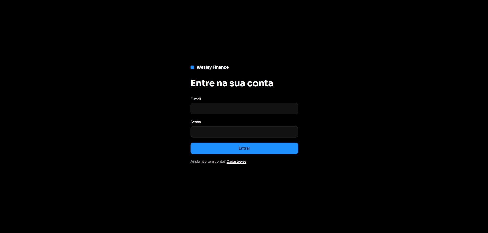
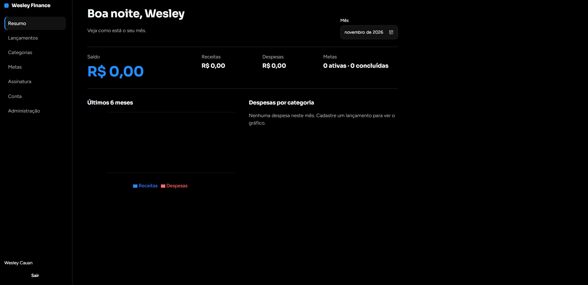

<h1 align="center">Wesley Finance</h1>

  Plataforma SaaS de controle financeiro pessoal, com assinatura mensal via Mercado Pago.

  <a href="https://wesley-finance.onrender.com">Ver demonstração</a>

<!-- Coloque aqui a foto do projeto: salve o print em docs/images/dashboard.png -->

  

  

## Sobre o projeto

O Wesley Finance permite que cada usuário controle suas receitas, despesas e metas financeiras em um painel com gráficos. O acesso aos dados financeiros é liberado por assinatura mensal, confirmada pelo backend através do webhook do Mercado Pago. O proprietário tem acesso administrativo vitalício e gratuito.

## O que foi desenvolvido

- **Contas e login seguros:** senhas com Argon2id, sessão com token de curta duração e renovação automática, bloqueio após tentativas erradas.
- **Painel financeiro:** saldo do mês, receitas, despesas, gráfico dos últimos 6 meses e despesas por categoria.
- **Lançamentos, categorias e metas:** cadastro completo, filtros, paginação e aportes em metas.
- **Assinatura com Mercado Pago:** checkout hospedado, webhook com validação de assinatura, histórico de pagamentos e cancelamento.
- **Painel administrativo:** indicadores de receita e assinantes, busca de usuários e bloqueio de contas (sem acesso aos dados financeiros dos usuários).
- **Personalização:** tema escuro, claro ou do sistema, e cores de destaque e de fundo por usuário.
- **LGPD:** consentimento registrado, exportação dos dados e exclusão da conta pelo próprio usuário.
- **Interface responsiva e acessível,** com animações suaves.

## Tecnologias

React · TypeScript · Vite · Framer Motion · Recharts · Node.js · Express · PostgreSQL · Docker · Mercado Pago · Render · Neon

